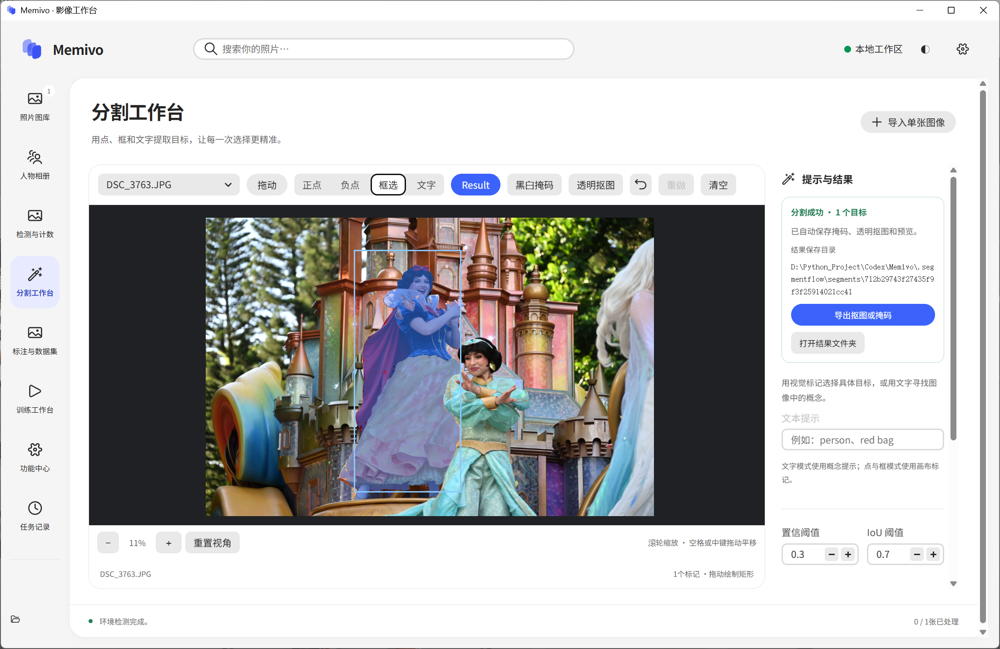
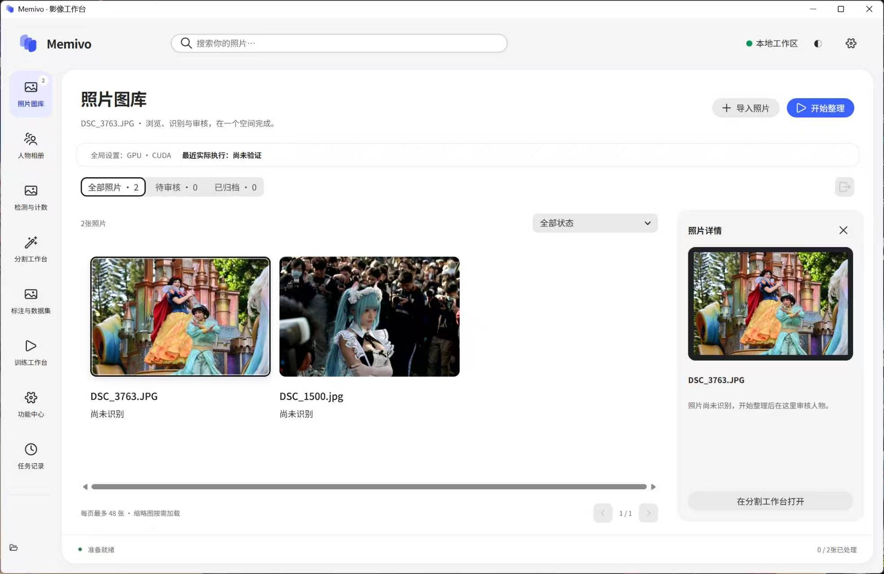
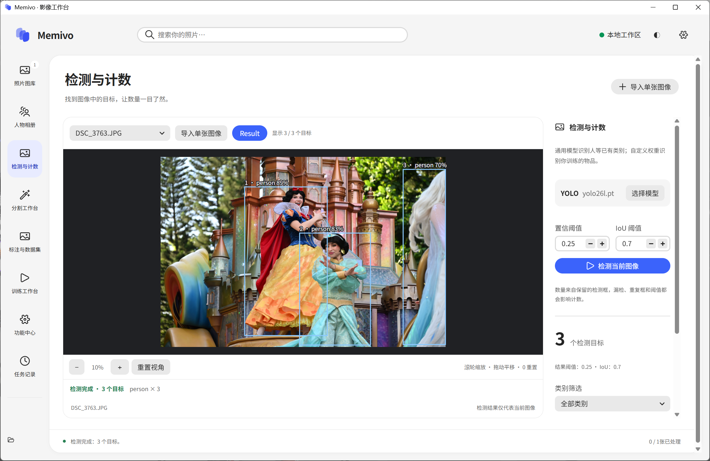
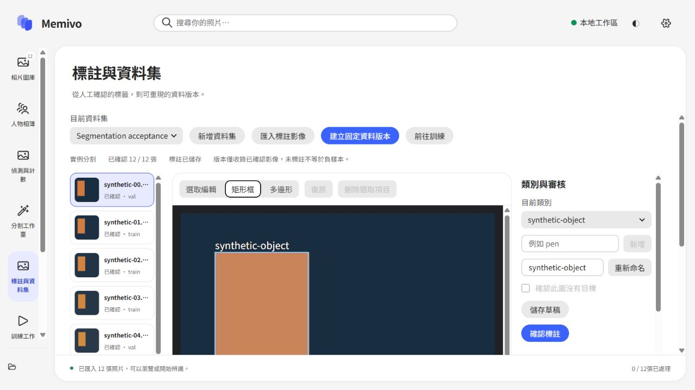
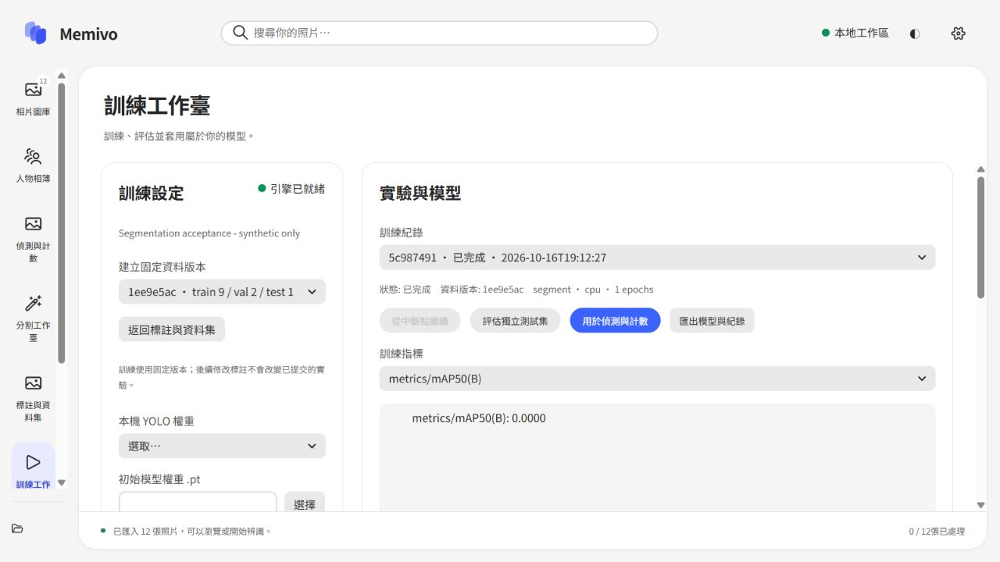

# Memivo

**Memivo — Organize memories, together.**

從共同的旅程，整理出屬於每個人的回憶。

Memivo 是一款在本機執行的桌面影像工作台，整合人物相簿、影像分割、物件偵測與計數、資料標註、資料集管理，以及 YOLO 模型訓練。

以 **Python + React + TypeScript + Adobe React Spectrum 2** 建構，透過 pywebview 與系統 WebView2 提供桌面介面。照片留在本機處理；AI 引擎與模型權重僅在使用者要求時下載。

**目前版本：v0.3.12 Preview · Windows x64**

[第一次使用](#first-use) · [環境需求](#requirements) · [功能截圖](#screenshots) · [原始碼啟動](#from-source) · [授權說明](#licensing)

## 想解決什麼問題？

一起旅行後拍下許多照片，返圖時卻需要反覆翻找每個人。Memivo 以參考照片、人物匹配與人工檢閱串起整理流程，也把去背、計數、標註和自訂模型訓練放進同一個工作空間。

| 你的需求 | Memivo 的流程 |
| --- | --- |
| 把合照整理給各個朋友 | 登記朋友與參考照 → 人物匹配 → 檢閱不確定結果 → 按人物匯出 |
| 從圖片切出物品 | SAM3 文字／點／框提示 → 檢查實例 → 匯出透明 PNG |
| 查看照片裡有多少人或物件 | 選擇符合任務的 YOLO 權重 → 偵測與分類計數 → 匯出結果 |
| 辨識預訓練模型沒有的物品 | 標註 → 審核 → 固定資料版本 → 訓練 → 獨立評估 → 套用 |

人物相簿匯出採複製方式，原圖保留。人物識別需要可用且符合條款的權重與人工檢閱；不承諾任意角度或遮擋的人像都能正確歸檔。



*使用者提供的 Windows 實機操作截圖；照片分割、遮罩預覽與匯出入口。截圖取自加入預熱控制之前的介面。*

<a id="first-use"></a>

## 第一次使用（First use）

建議先跑通一張照片的 CPU 偵測，再加入 SAM3 或人物識別。

1. **準備介面**：下載完整 Release ZIP，安裝 Python 3.12 x64 與 WebView2，解壓縮後啟動 `Memivo.exe`。
2. **安裝引擎**：在「功能中心」安裝視覺 AI 引擎，第一次先選 CPU。
3. **取得權重**：在官方模型目錄選 YOLO11 → 目標偵測 → `yolo11n.pt`，查看條款後下載。
4. **儲存設定**：掃描模型，選擇該權重與 CPU，儲存。多個模型時請明確選擇。
5. **開始使用**：匯入少量照片，在「偵測與計數」執行一次偵測，查看框與數量。

只想先熟悉介面或手動標註，可以暫不安裝 AI 引擎。官方預訓練類別不包含所有物品；自訂筆款、零件等目標通常需要另外標註與訓練。CPU 是流程驗證起點，不代表每個模型的推薦效能配置。

完整步驟、人物相簿／分割／訓練操作與常見問題，請看 **[首次使用指南](docs/FIRST_USE.md)**。如需繁體介面，於設定將 Language 改為「繁體中文」後儲存。

<a id="requirements"></a>

圖像畫布、遮罩保存位置與匯出方式見 [圖片工作臺指南](docs/IMAGE_WORKSPACES.md)。

## 環境需求

| 項目 | EXE 預覽包 | 原始碼啟動 |
| --- | --- | --- |
| 作業系統 | Windows 10/11 x64 | 本版以 Windows 為主要驗收平台 |
| Python | 建議 3.12 x64；支援 3.10–3.12 | 同左 |
| WebView2／.NET | 需要 | 需要桌面宿主環境 |
| Node.js LTS | 不需要 | 需要，用來建構前端 |
| 獨立顯示卡 | 非必要，可先使用 CPU | 同左 |
| 網路與磁碟 | 首次安裝介面／引擎與下載模型時需要；預留對應空間 | 另需 npm 相依套件 |

官方來源：[Python](https://www.python.org/downloads/windows/) · [WebView2](https://developer.microsoft.com/microsoft-edge/webview2/) · [Node.js](https://nodejs.org/)。視覺引擎估計 CPU 約 1–3 GB、NVIDIA 約 4–10 GB，實際依套件而異，另加權重與資料空間。


## 下載與啟動

在另一台 Windows 電腦使用時，建議下載 [Windows 預覽版 ZIP](https://github.com/MostimaJK/Memivo/releases/download/v0.3.12-preview/Memivo-0.3.12-preview-windows-x64.zip)。

1. 安裝 **Python 3.12 x64** 與 **Microsoft Edge WebView2 Runtime**。輕量啟動器使用 Windows 10/11 上的 .NET Framework 4.x。
2. 將**整個 ZIP** 解壓縮至可寫入的資料夾，讓 `Memivo.exe`、`app/` 與 `model/` 維持同一層。
3. 按兩下 `Memivo.exe`。首次啟動會建立獨立的介面環境並下載相依套件；此發布包**不需要 Node.js**。
4. 前往「功能中心」安裝需要的 AI 引擎。程式會偵測硬體，提供 CPU 或符合條件的 NVIDIA 安裝方案。
5. 從功能中心下載官方權重，或自行將權重放入對應的 `model/` 子資料夾，再於設定中按「掃描模型」。

此版本使用外部相依套件，未內附 Python、AI 引擎、模型權重或顯示卡驅動程式。應用程式資料儲存在 `%LOCALAPPDATA%/Memivo/`，權重則位於 EXE 旁的 `model/`。

詳細操作文件：[桌面啟動](docs/SPECTRUM_DESKTOP.md) · [引擎與權重](docs/OPTIONAL_ENGINES.md) · [標註與訓練](docs/LEARNING_WORKFLOW.md) · [模型目錄](model/README.md)。目前操作文件主要使用簡體中文。

## 主要功能

- **照片圖庫與人物相簿**：登記參考照片，以 LVFace／ArcFace 進行本機人物匹配，支援人工審核及按人物複製匯出。同一張合照可歸入多個人的相簿。
- **提示式分割與去背**：SAM3 文字、正負點與框選提示，可匯出個別實例或合併的透明 PNG。
- **偵測與計數**：使用官方或自訂 YOLO 權重，依類別篩選與計數、匯出 JSON，並將偵測框交給 SAM3 進一步分割。
- **標註與資料集**：可編輯矩形框與多邊形，區分草稿、已確認標註及負樣本；支援場景群組劃分、固定資料版本與 YOLO 格式匯出。
- **訓練與評估**：偵測／實例分割訓練、實際指標、停止與斷點恢復、獨立測試集評估，以及模型匯出與套用。
- **可選引擎**：獨立環境、安裝診斷、重試與解除安裝；移除引擎時保留照片、資料集及外部權重。
- **本機模型庫**：依用途分類的目錄、自動掃描、下拉選擇、官方規格入口，以及檔案大小與 SHA-256 校驗的 YOLO 下載。
- **三種介面語言**：简体中文、繁體中文與 English，並內附對應地區的字型子集。

<a id="screenshots"></a>

## 核心功能截圖

圖庫、偵測與分割使用使用者提供的 Windows 實機截圖（簡體介面）；標註及訓練保留繁體介面的合成資料驗收截圖。圖片展示操作流程，不代表所有照片都能達到相同精度；目前版另有模型載入控制，以及標題行的緊湊顯存指標。

### 相片圖庫

匯入、瀏覽與選取照片，讓後續整理或處理有一致的入口。



### 偵測與計數

在圖片上確認 YOLO 偵測框、類別及數量；可將選取的目標送入 SAM3。



### 分割與去背

頁首實機截圖展示框選提示、彩色遮罩、黑白遮罩／透明圖切換及結果匯出入口。

### 標註與資料集

人工確認標籤，管理場景劃分與固定資料版本；AI 候選仍需人工審核。



### 訓練工作臺

選取固定版本，執行訓練、檢視紀錄、評估與套用模型。下圖是少量合成資料的實際驗收紀錄，數值不作為精度成果宣傳。



截圖來源與範圍見 [圖片說明](docs/images/README.md)。

## 模型目錄

```text
model/
  face/detector/       # SCRFD 人臉偵測 ONNX
  face/recognition/    # LVFace／ArcFace 人物識別 ONNX
  sam3/               # sam3.pt
  yolo/detect/        # YOLO 偵測 .pt
  yolo/segment/       # YOLO 實例分割 .pt
```

官方目錄提供 YOLO11／YOLO26 偵測與分割的 n/s/m/l/x 規格、LVFace T/S/B/L、InsightFace 模型套件與 SAM3 官方存取入口。

某項用途尚未設定且只有一個候選時，程式會自動選取；已有的有效選擇會保留，多個候選則使用下拉選單。掃描不會將所有模型載入記憶體，實際相容性會在執行時檢查。詳見 [模型目錄說明](model/README.md)。人物識別第一次下載請看 [InsightFace 檔案對照與下載指南](docs/INSIGHTFACE_MODELS.md)，逐一說明壓縮包內哪些檔案需要使用。

<a id="from-source"></a>

## 從原始碼執行

需求：Windows、Python 3.10–3.12（建議 3.12）、Node.js LTS 與 WebView2。

```powershell
git clone https://github.com/MostimaJK/Memivo.git
cd Memivo
.\start_memivo.bat --check
.\start_memivo.bat
```

`start_memivo.bat` 是唯一的一鍵啟動 BAT；也可執行 `python main.py`。首次會準備介面環境並建構前端。可透過 `MEMIVO_PYTHON` 指定外部 Python。

原始碼模式沿用 `.segmentflow/` 儲存狀態；執行資料、權重及環境不納入 Git。`album_cli.py` 另提供命令列整理與人臉模型效能量測，並非重複的桌面啟動入口。

## 專案結構

| 路徑 | 用途 |
| --- | --- |
| `frontend/` | Spectrum 2 介面、多語系與字型資源 |
| `desktop/` | 本機 API、資料集、模型庫、訓練與環境管理 |
| `album/` | 人物特徵、匹配、快取與相簿匯出 |
| `scripts/` | 啟動、模型工作程序、發布建構與開發工具 |
| `model/` | 模型分類目錄與放置說明，不含權重 |
| `packaging/` | Windows EXE 啟動器原始碼 |
| `tests/` | 自動化測試 |
| `docs/` | 操作說明、硬體參考與介面圖片 |

## 驗證與目前限制

最近一次完整測試為 **71 項通過，1 項因 Windows 符號連結權限而略過**。TypeScript、前端建構與多語系檢查通過。

已實際驗證 CPU 引擎安裝、明確標示為合成資料的 YOLO 偵測／分割訓練、斷點恢復、評估與推論；官方 YOLO11n、YOLO26n 亦完成下載、校驗與 CPU 推論。Windows EXE 自我檢查通過。

上述結果驗證操作流程，不代表真實相簿的辨識精度。目標設備上的 GPU 訓練、真實 SAM3 權重與人臉模型仍待驗證。人體 ReID、主動學習，以及經量測的標註效率或延遲改善尚未完成，不作為既有成果宣稱。

執行檢查：

```powershell
python -m pip install -r requirements-spectrum.txt
python -m unittest discover -s tests -v
cd frontend
npm ci
npm run build
cd ..
node scripts/check_i18n.cjs
```

建構外部相依版 EXE：先完成前端建構，再於專案根目錄執行 `python scripts/build_release.py`。需要 Windows .NET Framework C# 建構工具；程式會拒絕覆寫已存在的發布目錄。

<a id="licensing"></a>

## 授權與模型條款

Memivo 自有程式與文件採用 **GNU GPL v3，僅限第 3 版（GPL-3.0-only）**。完整條款見 [LICENSE](LICENSE)，範圍與著作權聲明見 [NOTICE](NOTICE)。

GPL 允許商業使用、修改與再散布，也允許收費。散布受 GPL 規範的修改版或組合作品時，須依條款提供對應原始碼、保留授權與著作權聲明，並保障接收者享有相同權利。單純私人修改通常不要求公開；GPL 本身也不因提供網路服務就一律要求公開原始碼。程式不提供擔保。

Windows 發布壓縮包附有對應專案原始碼 ZIP（包含前端、Python 後端、C# 啟動器及建構腳本）；建構方式見包內 SOURCE.txt 與本文件。進一步說明見 [GPL 與第三方授權](docs/LICENSING_OPTIONS.md)。

第三方套件、字型與模型依各自條款辦理。Ultralytics 提供 AGPL／Enterprise 路徑；GPLv3 與 AGPLv3 組合時須遵守適用的 AGPL 網路互動義務。LVFace／InsightFace 部分官方權重僅供非商業研究，SAM3 使用獨立條款。自有程式採 GPL 不代表所有模型都可商用；引擎另行安裝或子程序隔離也不自動豁免授權義務。詳見 [第三方資訊](THIRD_PARTY_NOTICES.md)。原始碼倉庫與 Windows ZIP 均不重新散布模型權重。

### 模型載入與顯存監控

偵測與分割工作臺以單一按鈕切換「載入模型」「取消載入」「卸載模型」，旁邊顯示狀態。主動載入完成後保持就緒，不需先匯入圖片；卸載不刪除既有結果。YOLO、SAM3 可分別控制，SAM3 文字與點／框模式需分別載入；訓練等任務會釋放兩者。

NVIDIA CUDA 模式下，各工作區標題同一行顯示 **GPU 0 顯示卡總顯存**容量條，約每 2 秒更新；包含桌面及其他程式，不是 Memivo 獨占量，也不是 GPU 運算利用率。80% 起提示，95% 起警示；數值來自 nvidia-smi，讀取失敗或過期顯示暫不可用。CPU 模式或沒有 NVIDIA 工具時隱藏。

類別篩選以單行顯示名稱與數量；超過 6 個可見目標時預設精簡畫布標籤，懸停／選取查看詳情，亦可切換「完整標籤」。

工作臺採緊湊標題列：移除頁面副標題與重複匯入按鈕，圖片畫布使用剩餘高度。最近執行裝置可點選展開證據；效能、結果目錄及安裝說明按需展開。模型下載指引與錯誤資訊保留。

人物相簿空狀態將圖示、說明、登記按鈕與參考照片說明作為整組居中。後續效能規劃與程式碼檢查結果見 [效能與記憶體優化檢查](docs/PERFORMANCE_AUDIT.md)，尚未實作的項目與驗收方法已分開標示。
